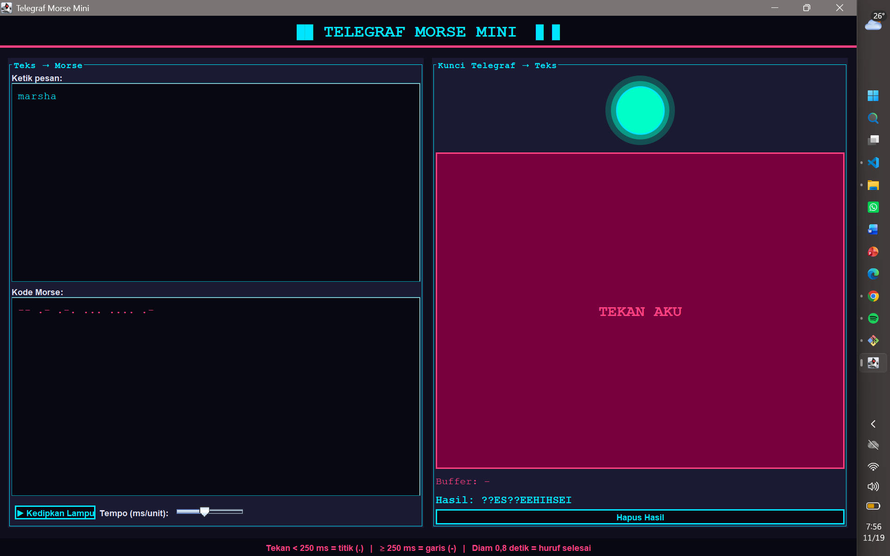
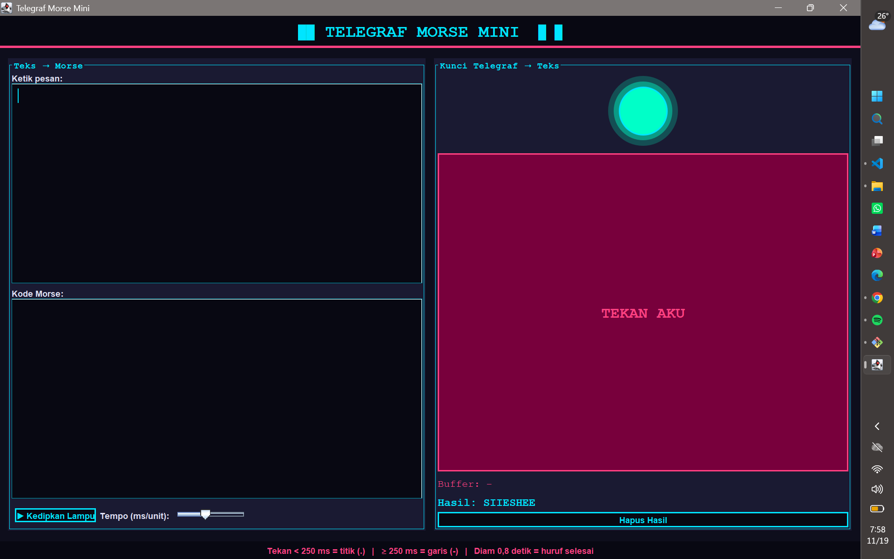
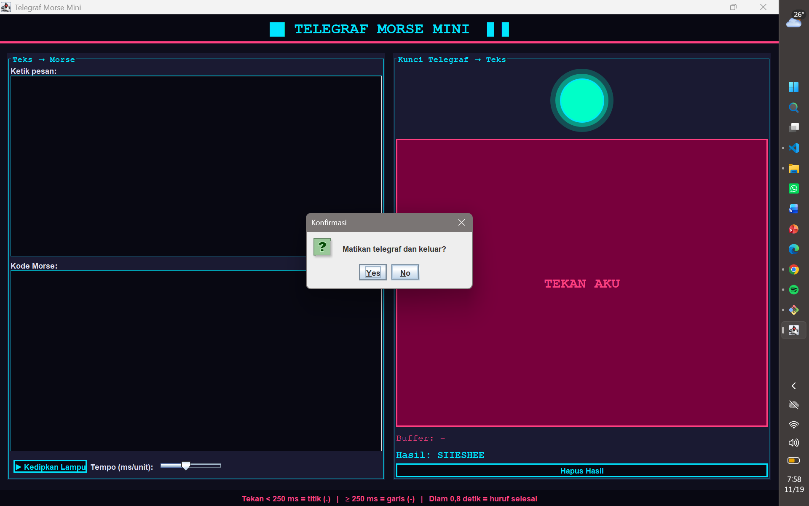

# Telegraf Morse Mini 📡

Aplikasi GUI Java Swing untuk latihan komponen GUI dan Event Listener.
Ada dua fitur utama:
1. **Teks → Morse**: ketik pesan, kode Morse muncul secara live, lalu bisa "dikedipkan" lewat lampu sinyal.
2. **Kunci Telegraf → Teks**: tekan tombol merah. Tekan singkat = titik, tekan lama = garis.
   Jika berhenti 0,8 detik, rangkaian titik/garis diterjemahkan menjadi huruf.

## Cara Menjalankan
```bash
javac TelegrafMorse.java
java TelegrafMorse
```
Membutuhkan JDK 8 atau lebih baru.

## Tema
Tema **Neon Cyberpunk**: latar biru gelap, aksen cyan dan pink neon, serta lampu sinyal dengan efek *glow*
(digambar manual lewat override `paintComponent` pada `LampPanel`).

## 5 Komponen Utama GUI

### 1. Top-Level Container Class
| Class | Peran |
|---|---|
| `javax.swing.JFrame` | Jendela utama aplikasi. `TelegrafMorse` meng-*extends* JFrame. Penutupan jendela diatur dengan `DO_NOTHING_ON_CLOSE` agar bisa dikonfirmasi lewat `WindowAdapter`. |

### 2. Intermediate Container Class
| Class | Peran |
|---|---|
| `javax.swing.JPanel` | Mengelompokkan komponen (header, kolom encoder, kolom kunci telegraf, footer). |
| `javax.swing.JScrollPane` | Membungkus `JTextArea` agar bisa di-scroll. |
| `javax.swing.border.TitledBorder` | Memberi judul pada panel (bukan container, tetapi pelengkap panel). |

### 3. Atomic Component Class
| Class | Peran |
|---|---|
| `JTextArea` | Input teks pesan dan output kode Morse (read-only). |
| `JButton` | Tombol "Kedipkan Lampu", "Hapus Hasil", dan kunci telegraf. |
| `JLabel` | Judul, buffer, hasil decode, dan petunjuk. |
| `JSlider` | Mengatur tempo kedipan lampu (60–300 ms/unit). |
| `LampPanel` (extends `JPanel`) | Komponen kustom hasil override `paintComponent` untuk menggambar lampu. |

### 4. Layout Classes
| Class | Dipakai di |
|---|---|
| `BorderLayout` | Frame utama (header/konten/footer) dan tiap panel kolom. |
| `GridLayout` | Membagi konten menjadi 2 kolom, dan menyusun label info. |
| `FlowLayout` | Header, footer, dan baris kontrol tempo. |

### 5. Event Listener
| Class / Interface | Method yang di-override | Fungsi |
|---|---|---|
| `KeyAdapter` | `keyReleased()` | Menerjemahkan teks ke Morse secara live. |
| `MouseAdapter` | `mousePressed()`, `mouseReleased()` | Mengukur durasi tekan: titik atau garis. |
| `WindowAdapter` | `windowClosing()` | Dialog konfirmasi sebelum keluar. |
| `ActionListener` (interface) | `actionPerformed()` | Tombol kedip lampu, hapus hasil, dan `javax.swing.Timer`. |

## Screenshot
| Tampilan Utama | Mode Kunci Telegraf |
|---|---|
|  |  |

| Dialog Konfirmasi (WindowAdapter) |
|---|
|  |

## Identitas
- NIM : F1D02410007
- Nama : Gusti Ayu Marsha Widyaswari